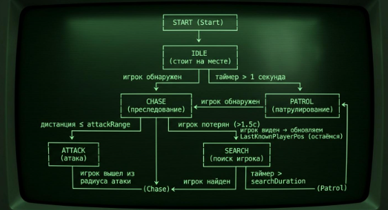
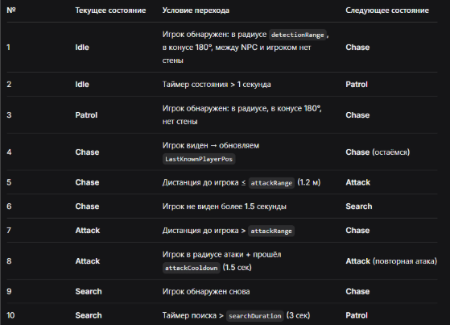
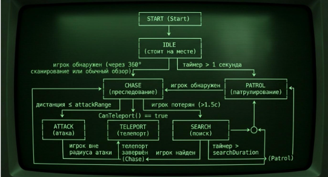
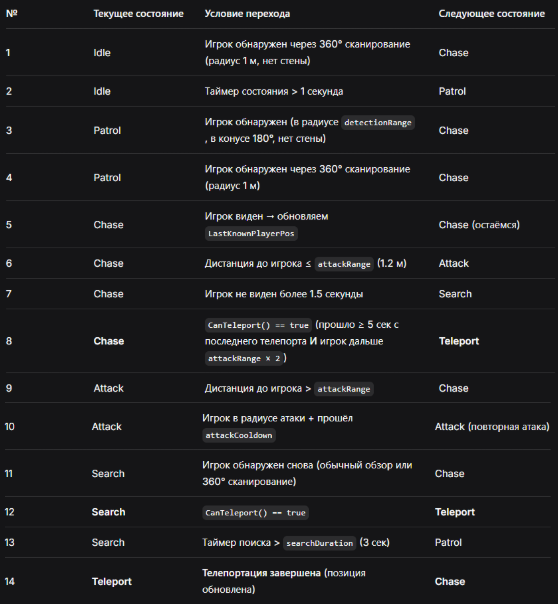

# Лабораторная работа 1
## Проектирование поведения NPC с использованием конечного автомата состояний

В ходе данной лабораторной работы я выполнила разработку небольшого игрового прототипа, в котором присутствует персонаж игрока и два типа вражеских NPC с различными способностями обнаружения и перемещения.
Поведение каждого врага реализовано с помощью конечного автомата состояний (FSM). Враг самостоятельно принимает решения в зависимости от положения игрока и текущего состояния игрового мира.


### Конечный автомат состояний для обычного врага

**Схема переходов**





**Таблица переходов**




### Конечный автомат состояний для телепортирующегося врага

**Схема переходов**





**Таблица переходов**




### Система восприятия:
Обычный враг (EnemyPatrol) использует направленное поле зрения:
угол обзора - 180°;
радиус обнаружения - задаётся параметром detectionRange;
проверка препятствий - Raycast/Line of Sight по слою Obstacle.
Игрок считается обнаруженным только если выполнены все три условия: расстояние в пределах радиуса, угол в пределах конуса, отсутствие стены между NPC и игроком.
Телепортирующийся враг (EnemyTeleport) дополнительно выполняет 360°-сканирование:
радиус - 1 метр;
периодичность - каждые 1.5 секунды;
проверка препятствий через Raycast.

### Логика поведения:
Оба врага реализуют одинаковый базовый конечный автомат:
Idle → Patrol → Chase → Attack (при обнаружении игрока)
Chase → Search → Patrol (при потере игрока)

### Особенности поведения:
Idle - враг стоит и ждёт; через 1 секунду бездействия переходит в патруль.
Patrol - движение по замкнутому маршруту из трёх точек.
Chase - преследование последней известной позиции игрока; обновление позиции при видимости.
Attack - удары с интервалом attackCooldown; выход из состояния при отдалении игрока.
Search - переход к последней известной позиции игрока; возврат к патрулю через searchDuration.
Teleport (только для второго врага) - мгновенное перемещение рядом с игроком с проверкой отсутствия препятствий.

### Вывод:
В ходе лабораторной работы я разработала систему искусственного интеллекта для двух типов вражеских NPC на основе конечного автомата состояний. Оба врага самостоятельно принимают решения в зависимости от положения игрока, видимости и текущей ситуации в игровом мире.
Первый враг (обычный) использует направленное поле зрения 180° и умеет патрулировать, преследовать, атаковать и искать игрока. Второй враг (телепортирующийся) дополнительно оснащён 360°-сканированием и способностью телепортироваться к игроку при определённых условиях.

## Код

### `PlayerController.cs`

```csharp
using System.Collections;
using System.Collections.Generic;
using UnityEngine;

public class PlayerController : MonoBehaviour
{
    public float speed = 5f;
    private Rigidbody2D rb;
    private Vector2 moveInput;

    void Start()
    {
        rb = GetComponent<Rigidbody2D>();
    }

    void Update()
    {
        // WASD или стрелки
        moveInput.x = Input.GetAxisRaw("Horizontal");
        moveInput.y = Input.GetAxisRaw("Vertical");
        moveInput = moveInput.normalized; // чтобы по диагонали не быстрее
    }

    void FixedUpdate()
    {
        rb.MovePosition(rb.position + moveInput * speed * Time.fixedDeltaTime);
    }
}
```

### `IEnemyState.cs`

```csharp
using System.Collections;
using System.Collections.Generic;


public interface IEnemyState
{
    void Enter(EnemyBase enemy);
    void Update(EnemyBase enemy);
    void Exit(EnemyBase enemy);
}
```

### `EnemyBase.cs`

```csharp
using System.Collections;
using System.Collections.Generic;
using UnityEngine;


public abstract class EnemyBase : MonoBehaviour
{
    [Header("Движение")]
    public float moveSpeed = 3f;

    [Header("Обнаружение")]
    public float detectionRange = 6f;
    public float attackRange = 1.2f;

    [Header("Атака")]
    public float attackCooldown = 1.5f;
    public int attackDamage = 10;
    public float lastAttackTime;

    [Header("Поиск")]
    public float searchDuration = 3f;

    [Header("Ссылки")]
    public Transform player;
    public LayerMask obstacleMask;
    public LayerMask playerMask;

    [Header("Отладка")]
    public string currentStateName;

    protected IEnemyState currentState;
    public Vector2 LastKnownPlayerPos { get; set; }
    public float StateTimer { get; set; }

    protected virtual void Start()
    {
        if (player == null)
        {
            GameObject p = GameObject.FindGameObjectWithTag("Player");
            if (p != null) player = p.transform;
        }

        ChangeState(new IdleState());
    }

    protected virtual void Update()
    {
        currentState?.Update(this);
        StateTimer += Time.deltaTime;
        currentStateName = currentState?.GetType().Name;
    }

    public void ChangeState(IEnemyState newState)
    {
        currentState?.Exit(this);
        currentState = newState;
        StateTimer = 0f;
        currentState.Enter(this);
        Debug.Log($"{name} -> {newState.GetType().Name}");
    }

    public virtual bool CanSeePlayer()
    {
        if (player == null) return false;

        Vector2 dir = (Vector2)player.position - (Vector2)transform.position;
        float dist = dir.magnitude;

        if (dist > detectionRange) return false;
        if (!IsInFieldOfView(dir)) return false;

        RaycastHit2D hit = Physics2D.Raycast(
            transform.position, dir.normalized, dist, obstacleMask);
        return hit.collider == null;
    }

    protected virtual bool IsInFieldOfView(Vector2 dir) => true;

    public void MoveTowards(Vector2 target)
    {
        Vector2 dir = (target - (Vector2)transform.position).normalized;
        Vector2 snapped = SnapTo8Directions(dir);
        transform.position += (Vector3)(snapped * moveSpeed * Time.deltaTime);
    }

    protected Vector2 SnapTo8Directions(Vector2 dir)
    {
        float angle = Mathf.Atan2(dir.y, dir.x) * Mathf.Rad2Deg;
        float snapped = Mathf.Round(angle / 45f) * 45f;
        float rad = snapped * Mathf.Deg2Rad;
        return new Vector2(Mathf.Cos(rad), Mathf.Sin(rad));
    }

    protected virtual void OnDrawGizmosSelected()
    {
        Gizmos.color = Color.yellow;
        Gizmos.DrawWireSphere(transform.position, detectionRange);

        Gizmos.color = Color.red;
        Gizmos.DrawWireSphere(transform.position, attackRange);

        if (Application.isPlaying)
        {
            Gizmos.color = Color.cyan;
            Gizmos.DrawLine(transform.position, LastKnownPlayerPos);
        }
    }
}
```

### `IdleState.cs`

```csharp
using System.Collections;
using System.Collections.Generic;
using UnityEngine;

public class IdleState : IEnemyState
{
    public void Enter(EnemyBase enemy)
    {
        // Ничего не делаем при входе
    }

    public void Update(EnemyBase enemy)
    {
        // Если видим игрока — переходим в погоню
        if (enemy.CanSeePlayer())
        {
            enemy.LastKnownPlayerPos = enemy.player.position;
            enemy.ChangeState(new ChaseState());
            return;
        }

        // Через 1 секунду начинаем патрулировать
        if (enemy.StateTimer > 1f)
        {
            enemy.ChangeState(new PatrolState());
        }
    }

    public void Exit(EnemyBase enemy)
    {
        // Ничего не делаем при выходе
    }
}
```

### `PatrolState.cs`

```csharp
using System.Collections;
using System.Collections.Generic;
using UnityEngine;


public class PatrolState : IEnemyState
{
    private Vector2[] points;
    private int index;

    public void Enter(EnemyBase enemy)
    {
        Vector2 origin = enemy.transform.position;
        points = new Vector2[]
        {
            origin + Vector2.right * 3f,
            origin + Vector2.up * 3f,
            origin + Vector2.left * 3f,
            origin + Vector2.down * 3f,
        };
        index = 0;
    }

    public void Update(EnemyBase enemy)
    {
        if (enemy.CanSeePlayer())
        {
            enemy.LastKnownPlayerPos = enemy.player.position;
            enemy.ChangeState(new ChaseState());
            return;
        }

        if (points == null || points.Length == 0) return;

        Vector2 target = points[index];
        enemy.MoveTowards(target);

        if (Vector2.Distance(enemy.transform.position, target) < 0.2f)
        {
            index = (index + 1) % points.Length;
        }
    }

    public void Exit(EnemyBase enemy) { }
}
```

### `ChaseState.cs`

```csharp
using System.Collections;
using System.Collections.Generic;
using UnityEngine;

public class ChaseState : IEnemyState
{
    public void Enter(EnemyBase enemy)
    {
        enemy.LastKnownPlayerPos = enemy.player.position;
    }

    public void Update(EnemyBase enemy)
    {
        if (enemy.player == null) return;

        float dist = Vector2.Distance(enemy.transform.position, enemy.player.position);

        if (enemy.CanSeePlayer())
        {
            enemy.LastKnownPlayerPos = enemy.player.position;
        }

        if (dist <= enemy.attackRange)
        {
            enemy.ChangeState(new AttackState());
            return;
        }

        if (!enemy.CanSeePlayer() && enemy.StateTimer > 1.5f)
        {
            enemy.ChangeState(new SearchState());
            return;
        }

        if (enemy is EnemyTeleport teleportEnemy && teleportEnemy.CanTeleport())
        {
            teleportEnemy.DoTeleport();
            return;
        }

        enemy.MoveTowards(enemy.LastKnownPlayerPos);
    }

    public void Exit(EnemyBase enemy) { }
}
```

### `AttackState.cs`

```csharp
using System.Collections;
using System.Collections.Generic;
using UnityEngine;


public class AttackState : IEnemyState
{
    public void Enter(EnemyBase enemy)
    {
        // Довернуться к игроку
        if (enemy.player != null)
            enemy.MoveTowards(enemy.player.position);
    }

    public void Update(EnemyBase enemy)
    {
        if (enemy.player == null) return;

        float dist = Vector2.Distance(
            enemy.transform.position, enemy.player.position);

        // Игрок вышел из радиуса — снова догоняем
        if (dist > enemy.attackRange)
        {
            enemy.ChangeState(new ChaseState());
            return;
        }

        // Атака по кулдауну
        if (Time.time - enemy.lastAttackTime >= enemy.attackCooldown)
        {
            enemy.lastAttackTime = Time.time;
            PerformAttack(enemy);
        }
    }

    private void PerformAttack(EnemyBase enemy)
    {
        Debug.Log($"{enemy.name} attacked for {enemy.attackDamage} damage!");
        // Сюда позже можно добавить: анимацию, звук, урон игроку
    }

    public void Exit(EnemyBase enemy) { }
}
```

### `SearchState.cs`

```csharp
using System.Collections;
using System.Collections.Generic;
using UnityEngine;


public class SearchState : IEnemyState
{
    public void Enter(EnemyBase enemy) { }

    public void Update(EnemyBase enemy)
    {
        // Снова увидели — догоняем
        if (enemy.CanSeePlayer())
        {
            enemy.LastKnownPlayerPos = enemy.player.position;
            enemy.ChangeState(new ChaseState());
            return;
        }

        // Идём к последней известной позиции
        enemy.MoveTowards(enemy.LastKnownPlayerPos);

        if (enemy is EnemyTeleport teleportEnemy && teleportEnemy.CanTeleport())
        {
            teleportEnemy.DoTeleport();
            return;
        }

            // Поиск закончился — возвращаемся к патрулю
            if (enemy.StateTimer > enemy.searchDuration)
        {
            enemy.ChangeState(new PatrolState());
        }
    }
    public void Exit(EnemyBase enemy) { }
    
}
```

### `TeleportState.cs`

```csharp
using System.Collections;
using System.Collections.Generic;
using UnityEngine;


public class TeleportState : IEnemyState
{
    public void Enter(EnemyBase enemy)
    {
        // Ищем безопасную точку рядом с игроком
        Vector2 destination = FindTeleportPoint(enemy);

        // Мгновенно перемещаемся
        enemy.transform.position = destination;

        Debug.Log($"{enemy.name} телепортировался в {destination}");
    }

    public void Update(EnemyBase enemy)
    {
        // Сразу после телепорта — обратно в погоню
        enemy.ChangeState(new ChaseState());
    }

    public void Exit(EnemyBase enemy) { }

    // Ищем точку рядом с игроком, где нет стен
    private Vector2 FindTeleportPoint(EnemyBase enemy)
    {
        Vector2 playerPos = enemy.player.position;

        // Пробуем 20 раз найти свободное место
        for (int i = 0; i < 20; i++)
        {
            // Случайная точка в радиусе 2–3 м вокруг игрока
            Vector2 offset = Random.insideUnitCircle.normalized * Random.Range(1.5f, 3f);
            Vector2 candidate = playerPos + offset;

            // Проверяем, что там нет препятствий
            Collider2D hit = Physics2D.OverlapCircle(candidate, 0.4f, enemy.obstacleMask);
            if (hit == null)
                return candidate;
        }

        // Не нашли — возвращаем текущую позицию (не телепортируемся)
        return enemy.transform.position;
    }
}
```

### `EnemyPatrol.cs`

```csharp
using System.Collections;
using System.Collections.Generic;
using UnityEngine;


using UnityEngine;

public class EnemyPatrol : EnemyBase
{
    [Header("Поле зрения")]
    public float fovAngle = 180f;

    protected override bool IsInFieldOfView(Vector2 dir)
    {
        float angle = Vector2.Angle(transform.up, dir);
        return angle <= fovAngle / 2f;
    }

    protected override void OnDrawGizmosSelected()
    {
        base.OnDrawGizmosSelected();

        Gizmos.color = Color.green;

        Vector3 leftDir = Quaternion.Euler(0, 0, fovAngle / 2f) * transform.up;
        Gizmos.DrawLine(transform.position, transform.position + leftDir * detectionRange);

        Vector3 rightDir = Quaternion.Euler(0, 0, -fovAngle / 2f) * transform.up;
        Gizmos.DrawLine(transform.position, transform.position + rightDir * detectionRange);
    }
}
```

### `EnemyTeleport.cs`

```csharp
using System.Collections;
using System.Collections.Generic;
using UnityEngine;


public class EnemyTeleport : EnemyBase
{
    [Header("Сканирование 360°")]
    public float scanRadius = 1f;       // радиус сканирования
    public float scanInterval = 1.5f;   // как часто сканировать (сек)

    [Header("Телепортация")]
    public float teleportCooldown = 5f;      // перезарядка способности
    public float teleportMaxDistance = 6f;   // макс. дистанция (для условия)

    private float lastScanTime;
    private float lastTeleportTime;

    protected override void Start()
    {
        base.Start();
        lastScanTime = 0f;
        lastTeleportTime = -100f; // чтобы сразу не телепортнулся
    }

    protected override void Update()
    {
        // Периодическое 360° сканирование
        if (Time.time - lastScanTime >= scanInterval)
        {
            lastScanTime = Time.time;
            Scan360();
        }

        base.Update();
    }

    // Сканирование во все стороны (360°)
    private void Scan360()
    {
        if (player == null) return;

        float dist = Vector2.Distance(transform.position, player.position);
        if (dist > scanRadius) return;

        // Проверяем, нет ли стены между врагом и игроком
        Vector2 dir = ((Vector2)player.position - (Vector2)transform.position).normalized;
        RaycastHit2D hit = Physics2D.Raycast(transform.position, dir, dist, obstacleMask);
        if (hit.collider != null) return; // стена — не видим

        // Игрок обнаружен!
        LastKnownPlayerPos = player.position;

        if (!(currentState is ChaseState) && !(currentState is AttackState))
        {
            ChangeState(new ChaseState());
            Debug.Log($"{name}: игрок обнаружен через 360° сканирование!");
        }
    }

    // Проверка, можно ли сейчас телепортироваться
    public bool CanTeleport()
    {
        // 1) Перезарядка прошла?
        if (Time.time - lastTeleportTime < teleportCooldown) return false;

        // 2) Игрок далеко? (условие телепорта)
        float dist = Vector2.Distance(transform.position, player.position);
        return dist > attackRange * 2f;
    }

    // Запуск телепортации
    public void DoTeleport()
    {
        lastTeleportTime = Time.time;
        ChangeState(new TeleportState());
    }

    // Рисуем радиус сканирования
    protected override void OnDrawGizmosSelected()
    {
        base.OnDrawGizmosSelected();

        Gizmos.color = Color.magenta;
        Gizmos.DrawWireSphere(transform.position, scanRadius);
    }
}
```
